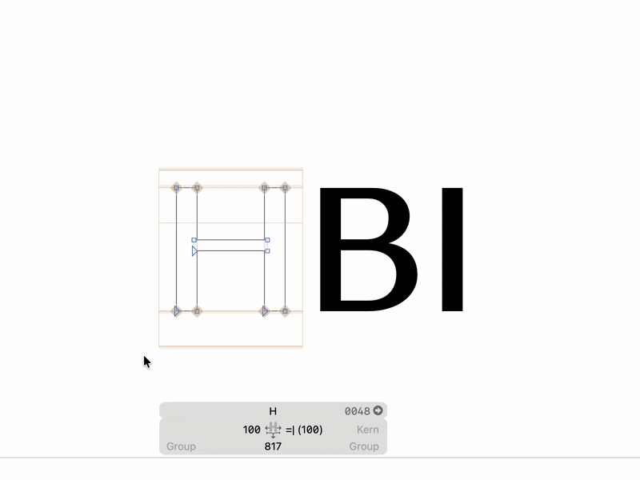

# Corner Hotkeys

A plugin for Glyphs 3 and Glyphs 4 for working with corner components using keyboard shortcuts.

## Shortcuts

- `1`–`5` — insert or replace a predefined corner component
- `Q` — mirror the selected corner component horizontally
- `§` — cycle through corner alignment modes by default; the key is configurable in Settings

Select a node or corner component before using a shortcut.

## Settings

Open:

**Glyph → Corner Hotkeys Settings…**

Assign a `_corner` glyph to each key using the dropdown menus. The shortcuts can also be temporarily enabled or disabled from the Glyph menu.

The plugin does not intercept keys while typing in text fields or palettes.

## Installation

Choose the plugin for your Glyphs version:

- **Glyphs 3:** `CornerHotkeys.glyphsPlugin`
- **Glyphs 4:** `CornerHotkeysG4.glyphsPlugin`

Drag the plugin onto the corresponding Glyphs app icon in the Dock, then restart Glyphs.

## Requirements

- Glyphs 3 or Glyphs 4
- Python module installed through the Glyphs Plugin Manager