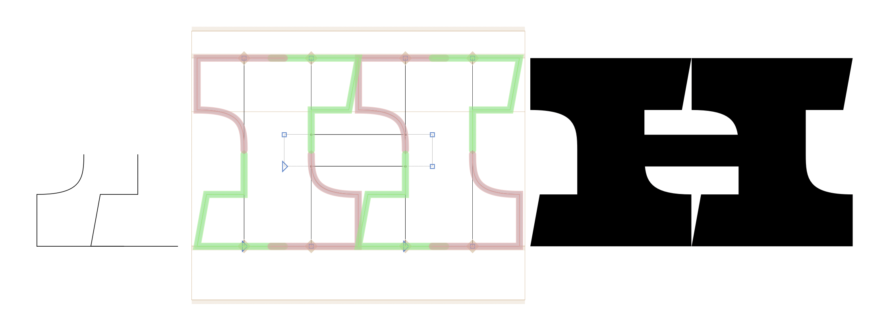

# Corner Hotkeys

A plugin for Glyphs 3 for working with corner components using keyboard shortcuts.

## Shortcuts

- `1`–`5` — insert or replace a predefined corner component
- `Q` — mirror the selected corner component horizontally
- `§` — cycle through corner alignment modes by default; the key is configurable in Settings

Select a node or corner component before using a shortcut.

## Settings

Open:

**Glyph → Corner Hotkeys Settings…**

Assign a `_corner` glyph to each key using the dropdown menus. The shortcuts can also be temporarily enabled or disabled from the Glyph menu.

## Installation

Drag `CornerHotkeys.glyphsPlugin` onto the Glyphs 3 app icon in the Dock, then restart Glyphs.

## Requirements

- Glyphs 3
- Python module installed through the Glyphs Plugin Manager

## Glyphs 4

An older version for Glyphs 4 is also available: [`CornerHotkeysG4.glyphsPlugin`](CornerHotkeysG4.glyphsPlugin). It is no longer maintained.
